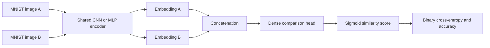

# Siamese Neural-Network Architecture Study

### Investigating how architecture, learning rate, depth, and initialization affect similarity learning on MNIST

## Overview

This academic project studies Siamese Neural Networks for image-pair similarity classification. It compares shared convolutional and multilayer-perceptron feature extractors while varying architectural depth, learning rate, and weight initialization.

Pairs of MNIST digit images are labeled as similar when they represent the same digit and dissimilar otherwise. The shared feature extractor maps both images into embeddings, which are concatenated and passed to a binary classifier.

## Features

- Siamese CNN and MLP implementations
- Shared feature-extractor weights across image pairs
- Programmatic similar/dissimilar pair generation
- Comparison of learning rates
- Comparison of Glorot and He initialization
- Layer-depth experiments
- Early stopping
- Training and validation accuracy/loss analysis
- Report, experimental notebooks, and spreadsheet results

## Architecture



### CNN Experiment

The CNN notebook uses stacked convolution, batch-normalization, and ReLU blocks followed by global average pooling and a dense embedding layer.

### MLP Experiment

The MLP notebook flattens each 28×28 image and applies shared dense/batch-normalization blocks before the comparison head.

## Experimental Design

- Dataset: MNIST handwritten digits
- Training sample: 100 randomly selected images
- Validation/test sample: 50 randomly selected images
- Pair label: `1` for the same digit class, otherwise `0`
- Training epochs: up to 10
- Batch size: 1024
- Loss: Binary cross-entropy
- Optimizer: Adam
- Primary metrics: Accuracy and loss

All Cartesian image pairs are generated within each sampled partition, producing 10,000 training pairs and 2,500 validation pairs.

## Project Structure

```text
.
├── RAML.ipynb                 # Siamese CNN experiments
├── raml2.ipynb                # Siamese MLP experiments
├── ramlresults.xlsx           # Recorded experiment results
├── RAML_Report_Sharath.pdf    # Academic report
└── README.md
```

## Setup

Clone the repository and create an environment:

```bash
git clone https://github.com/SharathKumarReddyAlijarla/Recent-Advancements-in-Machine-Learning.git
cd Recent-Advancements-in-Machine-Learning
python -m venv .venv
```

Activate it, then install the notebook dependencies:

```bash
python -m pip install tensorflow numpy matplotlib jupyter openpyxl
```

Start Jupyter:

```bash
jupyter notebook
```

## Usage

1. Open `RAML.ipynb` for the convolutional Siamese network.
2. Open `raml2.ipynb` for the MLP Siamese network.
3. Run cells from top to bottom.
4. Adjust learning rate, layer layout, or initializer for a new experiment.
5. Record comparable results in `ramlresults.xlsx`.

The notebooks download MNIST automatically through TensorFlow/Keras.

## Results

The original study reported the following observations:

- A learning rate of `0.001` produced the strongest recorded average validation result, with approximately **89.70% validation accuracy** and **0.2953 validation loss**.
- He initialization outperformed Glorot initialization in the documented comparisons.
- CNN performance was similar across the tested six- and seven-layer configurations.
- The seven-layer MLP slightly outperformed its six-layer version.
- The MLP achieved higher recorded accuracy and lower loss than the CNN in this small-sample experiment.
- Training accuracy remained higher than validation accuracy, indicating a generalization gap.

These are results from the documented experiment configuration, not universal conclusions about MLPs, CNNs, or Siamese networks.

## Technology Stack

| Area | Technology |
| --- | --- |
| Language | Python |
| Deep learning | TensorFlow, Keras |
| Dataset | MNIST |
| Experiment environment | Jupyter Notebook |
| Numerical processing | NumPy |
| Visualization | Matplotlib |
| Result storage | Microsoft Excel / openpyxl |

## Limitations

- Only 100 training images and 50 validation images are sampled from MNIST.
- Sampling is random and the notebooks do not set a consistent NumPy seed for every experiment.
- Cartesian pair generation scales quadratically and includes self-pairs.
- Results are based on a single small benchmark and should not be generalized to complex similarity tasks.
- The notebooks do not provide repeated runs, confidence intervals, or formal statistical significance tests.
- MNIST images are not explicitly normalized in every experiment path.
- The project is an academic architecture study, not a production verification system.

## Academic Context

This project was completed under the guidance of Prof. Dr.-Ing. Joeran Beel for the academic course **Recent Advancements in Machine Learning**.
